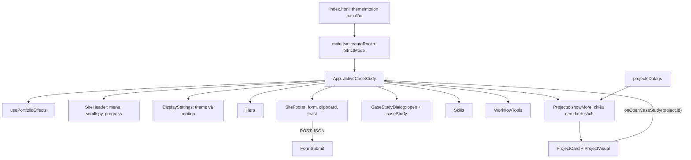
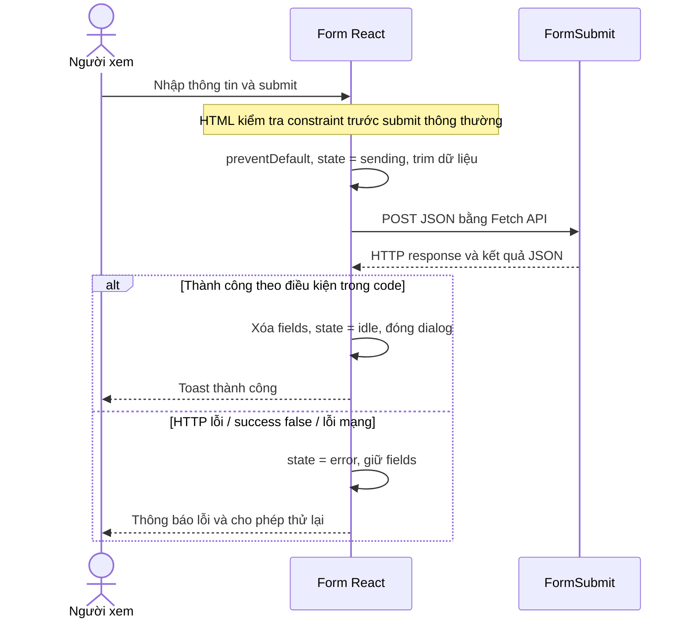

# Tài liệu kỹ thuật portfolio Trần Ngọc Tiến

Tài liệu này giải thích cách portfolio được tổ chức, logic của từng tương tác, các React hook, thuật toán giao diện và mục đích của từng thư viện. Nội dung được đối chiếu với mã nguồn trong repository tại ngày **16/10/2026**.

Phần “hình thành logic” dưới đây diễn giải từ yêu cầu đến cách triển khai đang có trong code, giúp đọc hiểu và trình bày dự án. Đây không phải bản ghi lịch sử các lần phát triển hay commit.

Để lấy nội dung ngắn đưa vào CV, xem [CV_SUMMARY_VI.md](CV_SUMMARY_VI.md).

## Mục lục

1. [Dự án giải quyết vấn đề gì?](#1-dự-án-giải-quyết-vấn-đề-gì)
2. [Thư viện, công cụ và dịch vụ](#2-thư-viện-công-cụ-và-dịch-vụ)
3. [Kiến trúc và luồng dữ liệu](#3-kiến-trúc-và-luồng-dữ-liệu)
4. [Từ yêu cầu đến logic triển khai](#4-từ-yêu-cầu-đến-logic-triển-khai)
5. [Các React hook được sử dụng](#5-các-react-hook-được-sử-dụng)
6. [Khởi tạo trang, theme và motion](#6-khởi-tạo-trang-theme-và-motion)
7. [Thuật toán điều hướng và tiến độ đọc](#7-thuật-toán-điều-hướng-và-tiến-độ-đọc)
8. [Custom hook usePortfolioEffects](#8-custom-hook-useportfolioeffects)
9. [Dữ liệu và danh sách dự án mở rộng](#9-dữ-liệu-và-danh-sách-dự-án-mở-rộng)
10. [Case study và dialog](#10-case-study-và-dialog)
11. [Form liên hệ, bất đồng bộ và thông báo](#11-form-liên-hệ-bất-đồng-bộ-và-thông-báo)
12. [CSS, responsive và motion design](#12-css-responsive-và-motion-design)
13. [Ảnh, icon, accessibility và metadata](#13-ảnh-icon-accessibility-và-metadata)
14. [Chạy dự án, kiểm tra và cấu hình triển khai](#14-chạy-dự-án-kiểm-tra-và-cấu-hình-triển-khai)
15. [Giới hạn hiện tại và hướng phát triển](#15-giới-hạn-hiện-tại-và-hướng-phát-triển)
16. [Câu hỏi phỏng vấn và bản đồ mã nguồn](#16-câu-hỏi-phỏng-vấn-và-bản-đồ-mã-nguồn)

## 1. Dự án giải quyết vấn đề gì?

Portfolio giới thiệu Trần Ngọc Tiến theo định hướng **Full-stack Developer**, giúp người xem đi từ thông tin cá nhân đến dự án, năng lực và liên hệ.

Các phần được render theo thứ tự:

| Phần                 | Câu hỏi được trả lời                    | Component / ID                                         |
| -------------------- | --------------------------------------- | ------------------------------------------------------ |
| Hero                 | Bạn là ai, định hướng gì?               | `Hero` / `home`                                        |
| Featured Projects    | Bạn đã làm gì, có bằng chứng nào?       | `Projects` / `work`                                    |
| Full-stack Toolkit   | Bạn dùng công cụ nào, vào việc gì?      | `Skills` / `stack`                                     |
| Development Workflow | Những công cụ nào hỗ trợ cách làm việc? | `WorkflowTools` / `workflow`                           |
| Contact              | Liên hệ hoặc tải CV bằng cách nào?      | `SiteFooter` / `contact`; liên kết CV ở header và hero |

Về triển khai, đây là **ứng dụng frontend React chạy phía trình duyệt**, build thành tài nguyên tĩnh. Repository hiện tại không chứa Express server, database, đăng nhập hoặc hệ thống backend riêng. Form liên hệ gọi dịch vụ FormSubmit bên ngoài.

Cần phân biệt hai lớp thông tin:

- **Công nghệ xây portfolio:** React, React DOM, JavaScript/JSX, Vite, Tailwind CSS, Lucide, CSS và API trình duyệt.
- **Công nghệ được kể trong portfolio:** Node.js, Express, MySQL, PostgreSQL, Flutter, Supabase, Firebase, BLoC, MQTT, FFmpeg… xuất hiện trong nội dung năng lực hoặc dự án. Việc hiển thị tên/logo không có nghĩa portfolio cài SDK hoặc thực thi những hệ thống này.

Các case study mô tả những dự án khác. Thuật toán tài chính, xử lý ảnh/video, tính thiên văn hay phát hiện té ngã của các dự án đó không được triển khai trong repository portfolio này.

## 2. Thư viện, công cụ và dịch vụ

### 2.1. Thư viện phục vụ giao diện

Phiên bản trong các bảng được lấy từ `package-lock.json`. `package.json` dùng phiên bản cố định với hầu hết package; Tailwind và Prettier dùng khoảng phiên bản có dấu `^`.

| Package        | Phiên bản khóa | Dùng để làm gì?                                              | Bằng chứng trong code                   |
| -------------- | -------------- | ------------------------------------------------------------ | --------------------------------------- |
| `react`        | `19.2.8`       | Tạo component, quản lý state, chạy effect và giữ DOM ref     | `App.jsx`, các component và custom hook |
| `react-dom`    | `19.2.8`       | Gắn cây React vào phần tử `#root` của trang HTML             | `createRoot` trong `src/main.jsx`       |
| `lucide-react` | `0.468.0`      | Cung cấp icon SVG cho nút, điều hướng, thẻ năng lực và sơ đồ | `src/components/ui/Icon.jsx`            |

Chỉ có ba package trên nằm trong `dependencies` trực tiếp. Không có Redux, Zustand, React Router, Axios, Framer Motion hay GSAP trong danh sách dependency trực tiếp của ứng dụng.

### 2.2. Công cụ phát triển và build

| Package                       | Phiên bản khóa | Vai trò thực tế                                                          |
| ----------------------------- | -------------- | ------------------------------------------------------------------------ |
| `vite`                        | `8.2.1`        | Chạy dev server, xử lý module và tạo bản build tĩnh trong `dist/`        |
| `@vitejs/plugin-react`        | `6.0.5`        | Tích hợp React/JSX và hỗ trợ Fast Refresh khi phát triển                 |
| `tailwindcss`                 | `4.2.2`        | Sinh CSS từ utility class sử dụng trong component                        |
| `@tailwindcss/vite`           | `4.2.2`        | Đưa bước xử lý Tailwind vào pipeline của Vite                            |
| `eslint`                      | `9.39.1`       | Phân tích tĩnh JavaScript/JSX                                            |
| `@eslint/js`                  | `9.39.1`       | Bộ quy tắc JavaScript recommended cho ESLint                             |
| `eslint-plugin-react`         | `7.37.5`       | Đang bật quy tắc `react/jsx-uses-vars` để nhận diện biến dùng trong JSX  |
| `eslint-plugin-react-hooks`   | `7.0.1`        | Áp dụng bộ quy tắc recommended cho React hook                            |
| `eslint-plugin-react-refresh` | `0.4.24`       | Cảnh báo cách export có thể ảnh hưởng Fast Refresh                       |
| `globals`                     | `16.5.0`       | Khai báo biến môi trường trình duyệt như `window`, `document` cho ESLint |
| `prettier`                    | `3.7.3`        | Định dạng JS, JSX, CSS, JSON và Markdown theo cấu hình chung             |

Tailwind nằm trong `devDependencies` vì được dùng trong quá trình build; trình duyệt nhận CSS đã tạo ra. Vite cũng là công cụ build/dev server, không phải backend xử lý nghiệp vụ của portfolio.

`package-lock.json` còn chứa dependency gián tiếp của các công cụ. Không nên liệt kê toàn bộ chúng như thư viện mà ứng dụng trực tiếp lựa chọn hoặc sử dụng trong nghiệp vụ.

### 2.3. Dịch vụ, tài nguyên và Web API

| Thành phần              | Mục đích                                                    | Cách sử dụng                                                       |
| ----------------------- | ----------------------------------------------------------- | ------------------------------------------------------------------ |
| FormSubmit              | Nhận dữ liệu form liên hệ                                   | `fetch` POST JSON tới `https://formsubmit.co/ajax/{email}`         |
| Google Fonts            | Tải font Sora và JetBrains Mono                             | Thẻ `<link>` và `preconnect` trong `index.html`                    |
| Devicon SVG             | Logo công cụ trong dải workflow                             | File SVG cục bộ ở `public/assets/icons/brands/`; kèm `LICENSE.txt` |
| PDF CV                  | Tải hoặc mở CV                                              | File trong `public/assets/`, đường dẫn cấu hình ở `portfolio.js`   |
| `localStorage`          | Lưu lựa chọn theme/motion giữa các lần truy cập             | Hai key `tien-portfolio-theme`, `tien-portfolio-motion`            |
| `matchMedia`            | Đọc tùy chọn giảm chuyển động của hệ điều hành khi khởi tạo | Truy vấn `(prefers-reduced-motion: reduce)`                        |
| `IntersectionObserver`  | Phát hiện phần tử đi vào vùng nhìn để reveal                | Custom hook `usePortfolioEffects`                                  |
| `MutationObserver`      | Đăng ký reveal cho node được thêm vào DOM                   | Theo dõi `childList` và `subtree` của `document.body`              |
| `requestAnimationFrame` | Gom cập nhật scroll theo frame; căn lại hash sau render     | `SiteHeader` và custom hook                                        |
| `AbortController`       | Gỡ listener theo `signal` khi cleanup                       | Custom hook; hiện không dùng để hủy request form                   |
| Native `<dialog>`       | Mở modal case study và form liên hệ                         | `showModal()`, `close()`, sự kiện cancel/click                     |
| Clipboard API           | Sao chép email                                              | `navigator.clipboard.writeText()`                                  |
| History API             | Cập nhật hash khi điều hướng                                | `history.replaceState()`                                           |

Những API trình duyệt ở bảng trên không phải thư viện npm. Đây là lý do nhiều tính năng tương tác không cần cài thêm package.

## 3. Kiến trúc và luồng dữ liệu

### 3.1. Cấu trúc thư mục

```text
index.html                         HTML gốc, metadata, khởi tạo theme/motion
src/
  main.jsx                         createRoot, StrictMode, import CSS
  App.jsx                          Ghép trang, giữ ID case study đang mở
  config/
    portfolio.js                   Navigation, thông tin liên hệ, liên kết
  components/
    layout/                        Header, display settings, footer/contact
    sections/                      Hero, Projects, Skills, WorkflowTools
    overlays/                      CaseStudyDialog
    ui/                            Icon, ProjectTags
  features/
    projects/                      Dữ liệu, card và ảnh minh họa dự án
    caseStudies/                   MoneyBoys, Health Monitor, thành phần chung
  hooks/
    usePortfolioEffects.js         Anchor scroll, reveal, initial hash
  styles/                          Token màu, nền tảng, motion, cursor, marquee
public/assets/                     Ảnh, icon SVG, PDF CV
docs/                              Tài liệu kỹ thuật và nội dung CV
```

Các file `index.js` trong nhóm component re-export component để `App` import gọn hơn. Chúng không tạo thêm state hay nghiệp vụ.

### 3.2. Cây component và đường đi của sự kiện



**Dữ liệu đi xuống qua props; sự kiện đi lên qua callback.** Ví dụ, `App` đưa `setActiveCaseStudy` xuống `Projects`; `ProjectCard` gọi callback với ID dự án; `App` render lại dialog tương ứng.

State được đặt gần nơi sử dụng:

- `App` giữ lựa chọn case study vì nút mở và dialog nằm ở hai nhánh component.
- Header tự giữ dữ liệu cuộn và menu vì những state này chỉ phục vụ điều hướng.
- `DisplaySettings` giữ theme/motion, sau đó đồng bộ ra thuộc tính của `<html>`.
- `Projects` giữ trạng thái mở rộng và chiều cao vùng danh sách.
- Footer tự quản lý form và thông báo.

Code hiện tại không cần một store tập trung cho các state này. CSS đọc theme/motion qua DOM attribute, không qua React Context.

## 4. Từ yêu cầu đến logic triển khai

Có thể trình bày quá trình thiết kế theo chuỗi **nhu cầu → dữ liệu/state → xử lý → phản hồi giao diện**:

| Nhu cầu                           | Dữ liệu hoặc state cần có                 | Cách xử lý                                     | Phản hồi                                     |
| --------------------------------- | ----------------------------------------- | ---------------------------------------------- | -------------------------------------------- |
| Người xem biết đang ở đâu         | ID section, `scrollY`, viewport           | Tìm section qua một điểm dò trên trang         | Dock đánh dấu mục đang đọc                   |
| Người xem biết đã đọc bao nhiêu   | Chiều cao trang, chiều cao viewport       | Chuẩn hóa vị trí cuộn về khoảng 0–1            | Thanh tiến độ và vòng tròn phần trăm         |
| Trang gọn nhưng giữ đủ dự án      | Mảng dự án, `showMore`, chiều cao ban đầu | Ẩn từ dự án thứ tư, mở vùng cuộn khi cần       | Ba dự án mặc định, View More / Show Less     |
| Xem giải thích sâu mà vẫn ở trang | `activeCaseStudy`                         | Nâng state lên `App`, mở native dialog         | Case study theo ID                           |
| Nhớ cách hiển thị người dùng chọn | `theme`, `motion`, storage                | Khởi tạo sớm rồi đồng bộ bằng effect           | Theme/motion nhất quán khi tải lại           |
| Có chuyển động theo ngữ cảnh      | `data-reveal`, vị trí hiển thị            | Observer thêm class, CSS quyết định animation  | Reveal, stagger, dialog entrance             |
| Gửi lời nhắn và biết kết quả      | `fields`, `formStatus`, `toast`           | Validate HTML, trim dữ liệu, POST và xử lý lỗi | Sending, thành công hoặc giữ form để thử lại |

Cách tổ chức này giúp mỗi tính năng có nguồn dữ liệu, nơi thay đổi trạng thái và kết quả nhìn thấy được. Không cần tạo thuật toán phức tạp khi một phép tính hoặc Web API đã đáp ứng yêu cầu.

## 5. Các React hook được sử dụng

### 5.1. useState: dữ liệu ảnh hưởng đến render

| Component         | State                           | Ý nghĩa                                             |
| ----------------- | ------------------------------- | --------------------------------------------------- |
| `App`             | `activeCaseStudy`               | `null` khi đóng; ID dự án khi mở                    |
| `SiteHeader`      | `menuOpen`                      | Mở/đóng menu mobile                                 |
| `SiteHeader`      | `activeSection`                 | Section đang đọc, mặc định `home`                   |
| `SiteHeader`      | `scrolled`                      | Trang đã cuộn quá 16px chưa                         |
| `SiteHeader`      | `hidden`                        | Header có ẩn theo hướng cuộn không                  |
| `SiteHeader`      | `progress`                      | Tiến độ đọc từ 0 đến 1                              |
| `DisplaySettings` | `theme`, `motion`               | Giao diện sáng/tối và mức chuyển động               |
| `Projects`        | `showMore`, `projectListHeight` | Mở rộng dự án và giữ chiều cao vùng danh sách       |
| `SiteFooter`      | `copyLabel`                     | Nhãn nút copy email                                 |
| `SiteFooter`      | `fields`                        | Giá trị bốn trường liên hệ                          |
| `SiteFooter`      | `formStatus`                    | Trạng thái `idle`, `sending`, `error` và thông điệp |
| `SiteFooter`      | `toast`                         | Thông báo tạm thời hoặc `null`                      |

Ví dụ cập nhật dựa vào giá trị trước:

```jsx
setMenuOpen((open) => !open);
setTheme((value) => (value === "dark" ? "light" : "dark"));
```

Functional updater nhận state gần nhất mà React cung cấp. Với object form, code tạo object mới thay vì sửa trực tiếp object cũ.

`DisplaySettings` dùng **lazy initializer**:

```jsx
const [theme, setTheme] = useState(() =>
  storedValue("tien-portfolio-theme", "light"),
);
const [motion, setMotion] = useState(initialMotionPreference);
```

React dùng hàm này khi khởi tạo state, tránh chủ động đọc storage mỗi lần component render. Trong StrictMode ở môi trường phát triển, initializer có thể được gọi thêm để kiểm tra tính thuần.

### 5.2. useRef: giữ tham chiếu DOM

| Nơi dùng          | Ref              | Mục đích                                              |
| ----------------- | ---------------- | ----------------------------------------------------- |
| `Projects`        | `projectListRef` | Đọc `offsetHeight`, gọi `scrollTo` cho vùng danh sách |
| `CaseStudyDialog` | `dialogRef`      | Kiểm tra `.open`, gọi `showModal()` hoặc `close()`    |
| `SiteFooter`      | `dialogRef`      | Mở/đóng form liên hệ bằng native dialog               |

Thay đổi `ref.current` không tự làm React render lại. Nếu giá trị cần phản ánh ra JSX như nhãn nút, phải dùng state; nếu cần điều khiển DOM như mở dialog, ref là cầu nối phù hợp.

`previousY` và `frame` trong header là biến cục bộ được callback của effect giữ qua closure, không phải React ref. Effect tạo lại chúng khi `menuOpen` thay đổi.

### 5.3. useEffect: đồng bộ với môi trường ngoài React

| Nơi dùng              | Dependency    | Công việc                                                 | Cleanup                                        |
| --------------------- | ------------- | --------------------------------------------------------- | ---------------------------------------------- |
| `usePortfolioEffects` | `[]`          | Cài anchor listener, observer, căn initial hash           | Abort listener, disconnect observer, hủy frame |
| `SiteHeader`          | `[menuOpen]`  | Cập nhật scrollspy/progress/header; nghe scroll và resize | Gỡ listener, hủy frame                         |
| `SiteHeader`          | `[menuOpen]`  | Đồng bộ `body.menu-open`, nghe Escape                     | Bỏ class, gỡ keydown listener                  |
| `DisplaySettings`     | `[theme]`     | Ghi `data-theme`, meta theme-color và storage             | Không có tài nguyên cần hủy                    |
| `DisplaySettings`     | `[motion]`    | Ghi `data-motion`                                         | Không có tài nguyên cần hủy                    |
| `CaseStudyDialog`     | `[open]`      | Đồng bộ React state với native dialog và body class       | Bỏ `dialog-open`                               |
| `SiteFooter`          | `[copyLabel]` | Đặt lại nhãn copy sau 2 giây nếu nhãn đã đổi              | `clearTimeout`                                 |
| `SiteFooter`          | `[toast]`     | Tự ẩn toast sau 4,5 giây                                  | `clearTimeout`                                 |
| `SiteFooter`          | `[]`          | Đăng ký cleanup body class lúc unmount                    | Bỏ `dialog-open`                               |

Cleanup tránh để listener, observer, frame hoặc timer tiếp tục hoạt động sau khi phần giao diện tương ứng đã được tháo. Điều này cũng giúp effect chịu được chu kỳ setup → cleanup → setup mà StrictMode có thể chạy thêm ở môi trường phát triển.

Không có `useMemo`, `useCallback`, `useReducer`, `useContext` hay `useLayoutEffect` trong mã nguồn hiện tại. Không nên đưa chúng vào phần mô tả kỹ thuật như tính năng đã triển khai.

## 6. Khởi tạo trang, theme và motion

### 6.1. Luồng tải ban đầu

1. Trình duyệt đọc `index.html`, metadata, font và script khởi tạo trong `<head>`.
2. Script đọc theme/motion đã lưu và đặt `data-theme`, `data-motion` trước khi React render.
3. `main.jsx` import CSS, gọi `createRoot()` và render `<App />` bên trong `<StrictMode>`.
4. `App` render các section, header, footer và case study dialog.
5. Effect được thiết lập: đồng bộ setting, lắng nghe cuộn, đăng ký reveal và xử lý hash ban đầu.

Khởi tạo theme sớm giúp giảm khả năng xuất hiện một khung hình sai theme trước khi React hoàn tất. Đây là ý đồ từ cấu trúc code, không phải kết quả đo hiệu năng đã công bố.

### 6.2. Quy tắc chọn motion

```text
Nếu giá trị đã lưu là "full" hoặc "reduced":
    dùng lựa chọn đã lưu
Ngược lại:
    nếu hệ điều hành yêu cầu giảm chuyển động: dùng "reduced"
    nếu không: dùng "full"
```

Khi người dùng bấm toggle, code đổi state và ghi giá trị mới vào storage. Lựa chọn rõ ràng của người dùng có quyền ưu tiên hơn mặc định của hệ điều hành.

Điểm cần biết: component đọc tùy chọn hệ điều hành khi khởi tạo; chưa đăng ký listener theo dõi việc hệ điều hành đổi tùy chọn trong lúc trang đang mở.

### 6.3. Quy tắc chọn theme

Mặc định là `light`; lựa chọn được lưu sau mỗi thay đổi. Script HTML chỉ coi `dark` là dark và chuẩn hóa các giá trị khác về light. `DisplaySettings` đọc chuỗi từ storage với fallback light, chưa có bước kiểm tra chuỗi theme hợp lệ giống script HTML.

Mỗi lần theme đổi, effect cập nhật:

- `document.documentElement.dataset.theme`.
- `<meta name="theme-color">`: `#050816` cho dark, `#f7f4ff` cho light.
- `localStorage`.

Các thao tác storage đều có `try/catch` để setting vẫn hoạt động trong bộ nhớ nếu trình duyệt không cho đọc/ghi storage. Theme hiện không tự chọn theo `prefers-color-scheme`.

## 7. Thuật toán điều hướng và tiến độ đọc

Nguồn chính: [`SiteHeader.jsx`](../src/components/layout/SiteHeader.jsx).

### 7.1. Gom sự kiện cuộn bằng requestAnimationFrame

Scroll có thể phát sinh nhiều lần giữa hai frame. Header dùng một biến `frame` để chỉ giữ một callback đang chờ:

```js
const requestUpdate = () => {
  if (!frame) frame = requestAnimationFrame(update);
};
```

Khi `update` chạy, nó đặt `frame = 0`, đọc vị trí cuộn rồi cập nhật các state liên quan. Listener scroll dùng `{ passive: true }` và không chặn hành vi cuộn mặc định.

Đây là kỹ thuật gom xử lý theo nhịp render, không phải debounce chờ người dùng ngừng cuộn. Nó giảm số lần chạy phép tính so với việc tính lại ngay trong mọi sự kiện; không tự bảo đảm một mức FPS hay mức cải thiện cụ thể.

### 7.2. Scrollspy: chọn section đang đọc

Đặt:

```text
y = max(window.scrollY, 0)
probe = y + 64 + viewportHeight × 0.2
```

`probe` là điểm dò nằm gần phần trên viewport, có cộng khoảng bù. Code duyệt `portfolioNavigation` theo thứ tự và giữ ID cuối cùng có `offsetTop <= probe`.

Ví dụ, nếu vị trí đầu của Projects đã đi qua điểm dò còn Skills chưa đi qua, `activeSection = "work"`. Dock sử dụng state này để mở rộng nhãn, đổi màu và đặt `aria-current="location"`.

Với `n` mục điều hướng, mỗi lần cập nhật duyệt **O(n)** mục và dùng **O(1)** bộ nhớ phụ. Hiện có năm mục nên duyệt tuyến tính là dễ hiểu và phù hợp. Thuật toán này dựa vào thứ tự navigation khớp thứ tự section trên trang.

Điểm bù `64` trong scrollspy là hằng số. Nó khác với anchor scroll ở custom hook, nơi code đọc chiều cao header thực tế.

### 7.3. Tính tiến độ đọc

```text
range = max(documentHeight - viewportHeight, 1)
progress = min(y / range, 1)
percentage = round(progress × 100)
angle = progress × 360 độ
```

Ví dụ: trang cao 5.000px, viewport cao 1.000px, cuộn 2.000px thì `range = 4.000`, `progress = 0.5`, phần trăm là 50 và góc vòng tròn là 180°.

- Thanh phía trên dùng `transform: scaleX(progress)` với gốc bên trái.
- Vòng tròn ở dock dùng `conic-gradient` và góc đã tính.
- Progressbar cung cấp `aria-valuenow` cho công nghệ hỗ trợ.
- Mẫu số tối thiểu 1 tránh phép chia cho 0 khi trang ngắn.

### 7.4. Header ẩn/hiện theo hướng cuộn

Mỗi lần cập nhật, code so sánh `y` với `previousY`:

| Điều kiện                                                      | Hành vi                                                 |
| -------------------------------------------------------------- | ------------------------------------------------------- |
| `y > 16`                                                       | Bật trạng thái đã cuộn, thêm shadow/backdrop của header |
| Rộng ít nhất 1.024px, `y > 120`, cuộn xuống hơn 5px, menu đóng | Cho phép ẩn header                                      |
| Cuộn lên hơn 5px hoặc `y < 80`                                 | Hiện header                                             |
| Độ lệch lớn hơn 3px                                            | Cập nhật mốc `previousY`                                |

Đây là logic dùng ngưỡng để hạn chế phản ứng với chuyển động rất nhỏ. Nhánh đặt `hidden` vẫn được tính lại mỗi lần `update`; không nên mô tả như một bộ điều khiển có trạng thái giữ ngưỡng phức tạp hơn code thực tế.

Menu mobile đóng khi chọn liên kết hoặc bấm Escape. Khi menu mở, `body.menu-open` khóa cuộn nền. Ở chế độ reduced motion, CSS giữ header hiển thị ngay cả khi state có thể đánh dấu ẩn.

## 8. Custom hook usePortfolioEffects

Nguồn: [`usePortfolioEffects.js`](../src/hooks/usePortfolioEffects.js). Hook được gọi trong `App`, gom các tác vụ liên quan tới DOM của toàn trang.

### 8.1. Anchor scroll và event delegation

Thay vì gắn listener riêng cho từng anchor, hook gắn một listener `click` trên `document` rồi tìm liên kết gần nhất bằng `event.target.closest(...)`.

Selector chỉ chọn anchor bắt đầu bằng `#` và không phải `href="#"`. Khi tìm thấy target:

```text
headerOffset = chiều cao phần tử [data-header], fallback 64
top = 0 nếu target là home
top = target.offsetTop - headerOffset nếu là section khác
top = max(top, 0)
```

Sau đó `scrollTo` dùng `smooth` khi motion đầy đủ và `auto` khi reduced. `history.replaceState()` cập nhật hash mà không tạo thêm một history entry cho mỗi lần chọn section.

Event delegation cũng xử lý được anchor được thêm sau này mà không phải gắn lại từng listener. Navigation vẫn là liên kết HTML; dự án không sử dụng React Router.

### 8.2. Reveal bằng IntersectionObserver

Luồng xử lý:

1. Lấy các phần tử có `data-reveal`.
2. Dùng một `IntersectionObserver` chung để theo dõi, với `rootMargin: "0px"`.
3. Khi `entry.isIntersecting` đúng, thêm `is-revealed`.
4. Gọi `unobserve()` với phần tử đã reveal.
5. CSS thực hiện opacity/transform và hiệu ứng riêng của từng loại component.

Không có threshold tùy chỉnh trong code; không nên mô tả rằng phần tử phải hiển thị đủ 50% mới chạy. Reveal là một lần cho phần tử đang tồn tại, không reset class mỗi khi nó rời viewport.

Nếu trình duyệt không hỗ trợ `IntersectionObserver`, hook thêm `is-revealed` ngay cho các phần tử đã tìm được, để nội dung ban đầu không bị giữ trong trạng thái ẩn.

### 8.3. Vì sao có MutationObserver?

React có thể thêm node mới sau lần đăng ký observer đầu tiên, chẳng hạn khi nội dung case study thay đổi. Hook theo dõi node được thêm vào `document.body`, kiểm tra node đó và các hậu duệ có `data-reveal`, rồi đăng ký chúng với IntersectionObserver.

Hai observer giải quyết hai việc khác nhau:

- IntersectionObserver trả lời: phần tử đã đi vào vùng nhìn chưa?
- MutationObserver trả lời: DOM vừa có phần tử mới nào cần đăng ký?

Các project card được render sẵn ngay từ đầu, nên View More chủ yếu đổi `display` của node đã tồn tại. Không cần MutationObserver để phát hiện chính thao tác đổi class này; IntersectionObserver đã theo dõi các card chưa reveal.

MutationObserver đang quan sát toàn bộ body và chỉ xử lý node thêm mới, không theo dõi mọi lần đổi thuộc tính. Nếu ứng dụng lớn hơn, có thể thu hẹp phạm vi quan sát.

### 8.4. Căn lại hash khi truy cập trực tiếp

Khi mở `/#work`, trình duyệt có thể thử nhảy tới anchor trước khi React tạo section. Hook căn lại vị trí:

- Qua `requestAnimationFrame` sau khi effect được thiết lập.
- Sau `document.fonts.ready` vì font có thể làm thay đổi kích thước chữ/layout.
- Một lần ở sự kiện `load` nếu trang chưa tải xong.

Những lần căn này dùng vị trí đã trừ header và `behavior: "instant"`. Khi cleanup, hook hủy frame và dùng cờ `hashAlignmentCancelled` để callback chờ font không tiếp tục thao tác sau unmount.

Đây là căn lại initial hash; code chưa có listener riêng cho tất cả thay đổi hash hoặc thao tác Back/Forward về sau.

### 8.5. Cleanup tập trung

Listener anchor và listener load nhận chung `AbortSignal`; `controller.abort()` gỡ chúng khi cleanup. Các hàm trong mảng `cleanups` disconnect observer và hủy công việc đang chờ.

Hook cũng bỏ class `no-js` trên `<html>` và đặt ngôn ngữ tài liệu là tiếng Anh, khớp copy công khai. Class `no-js` chỉ là cơ chế bảo vệ CSS reveal; portfolio vẫn cần JavaScript để render vì HTML gốc chỉ có `#root`, không chứa sẵn toàn bộ nội dung.

## 9. Dữ liệu và danh sách dự án mở rộng

Nguồn: [`Projects.jsx`](../src/components/sections/Projects.jsx), [`projectsData.js`](../src/features/projects/projectsData.js), [`ProjectCard.jsx`](../src/features/projects/ProjectCard.jsx), [`ProjectVisual.jsx`](../src/features/projects/ProjectVisual.jsx).

### 9.1. Tách dữ liệu khỏi cách hiển thị

Mỗi project là object. Các trường quan trọng:

| Trường                          | Ý nghĩa                                                                                |
| ------------------------------- | -------------------------------------------------------------------------------------- |
| `id`, `name`                    | Định danh và tên hiển thị                                                              |
| `accent`, `tags`                | Màu nhấn và ngữ cảnh dự án                                                             |
| `headline`, `description`       | Tóm tắt giá trị và đóng góp                                                            |
| `evidence`                      | Mảng cặp nhãn/nội dung về contribution, engineering focus, tool roles, outcome/context |
| `flow`                          | Các lớp hệ thống, mỗi lớp có icon, label và value                                      |
| `repository`, `repositoryLabel` | Liên kết bằng chứng và nhãn tương ứng                                                  |
| `hasCaseStudy`                  | Có hiển thị nút mở case study không                                                    |
| `visual`                        | Kiểu ảnh, đường dẫn ảnh, nền và chú thích bằng chứng                                   |

`ProjectCard` render cấu trúc chung; `ProjectTags` render context tag; `ProjectVisual` chọn nhánh hiển thị theo `visual.type`.

Đây là cách render theo dữ liệu. Khi thêm dự án có cấu trúc tương tự, phần lớn công việc nằm ở dữ liệu. Nếu thêm kiểu visual hoặc case study mới thì cần cập nhật logic component tương ứng.

### 9.2. Chính xác ba dự án mặc định

```jsx
const DEFAULT_PROJECT_COUNT = 3;

// Trong vòng map của projects:
className={!showMore && index >= DEFAULT_PROJECT_COUNT ? "hidden" : ""}
```

Code vẫn `map` toàn bộ mảng, dùng class `hidden` để ẩn dự án từ vị trí thứ tư. Không dùng `slice(0, 3)` để loại chúng khỏi cây render, không phân trang server và không fetch thêm dữ liệu khi mở rộng.

Thứ tự hiện tại:

1. MoneyBoys — `University Team Project`, `Finance App`.
2. Mobile Teleprompter — `Team Project`, `In Development`.
3. Sky Tonight — `Team Project`, `Astronomy App`.
4. IoT Health Monitor — `Course Project`, `IoT Prototype`; nằm trong phần mở rộng.

### 9.3. Giữ chiều cao khi mở rộng

Khi bấm View More:

1. Đọc `offsetHeight` hiện tại của vùng danh sách qua ref.
2. Lưu chiều cao vào state `projectListHeight`.
3. Đặt `showMore = true`, bỏ ẩn các project phía sau.
4. Áp dụng chiều cao đã lưu và `overflow-y-auto` để cuộn **bên trong vùng dự án**.

Như vậy, View More hiện không làm toàn bộ danh sách kéo dài tự do theo chiều cao trang; nó giữ kích thước vùng đã đo rồi cung cấp cuộn nội bộ.

Khi Show Less, code yêu cầu vùng danh sách cuộn về đầu, đặt `showMore = false` và xóa chiều cao cố định. `aria-expanded`, `aria-controls` và `tabIndex` giúp diễn đạt trạng thái và cho phép focus vào vùng cuộn khi mở rộng.

Giới hạn: chiều cao được đo một lần khi mở. Chưa có ResizeObserver để đo lại khi viewport thay đổi. Lệnh cuộn lúc thu gọn đang truyền `behavior: "smooth"` trực tiếp, chưa đọc setting motion như anchor scroll.

### 9.4. Chọn visual và giữ đúng ngữ cảnh bằng chứng

- `moneyboys`: logo nền và screenshot lấy từ build dự án, kèm chú thích nguồn.
- `gallery`: ba ảnh tham chiếu giao diện của Teleprompter hoặc Sky Tonight, ghi rõ visual reference.
- Nhánh còn lại: sơ đồ minh họa hệ thống cho IoT Health Monitor, kèm nhãn academic/public repository.

Ảnh tham chiếu không được diễn giải thành screenshot của chính bản build đã triển khai. IoT là prototype học phần; portfolio không chạy cảm biến, MQTT hoặc thuật toán đo sức khỏe.

## 10. Case study và dialog

Nguồn: [`CaseStudyDialog.jsx`](../src/components/overlays/CaseStudyDialog.jsx) và [`features/caseStudies`](../src/features/caseStudies).

### 10.1. Nâng state lên component cha

```text
App.activeCaseStudy = null
    ↓ người xem bấm Read Case Study
ProjectCard gọi onOpenCaseStudy(project.id)
    ↓
App.activeCaseStudy = ID
    ↓
CaseStudyDialog nhận open = true và caseStudy = ID
    ↓
effect gọi dialog.showModal()
```

Khi đóng, callback đặt `activeCaseStudy = null`; effect đồng bộ native dialog về trạng thái đóng. React quyết định case study nào cần mở; DOM API thực hiện thao tác modal.

Các cách đóng gồm nút X, Escape qua `onCancel`, hoặc click có `event.target === event.currentTarget` trên chính dialog. Phép so sánh target này tránh đóng khi bấm vào phần tử con của nội dung.

`body.dialog-open` khóa cuộn nền. Native dialog được dùng làm nền tảng hành vi modal/focus; code không tự viết một thuật toán focus trap riêng.

### 10.2. Nội dung và component tái sử dụng

Hiện chỉ có hai case study:

- `health-monitor` → `HealthMonitorStudy`.
- Nhánh còn lại → `MoneyBoysStudy`.

`StudyParts.jsx` cung cấp `StudyHeading`, `StudyFlow`, `StudyFacts`, `StudyLink`, giúp các case study dùng chung cấu trúc tiêu đề, sơ đồ, số liệu ngữ cảnh và liên kết bằng chứng.

Các sơ đồ `StudyFlow` và `project.flow` là cách trình bày kiến trúc, không phải pipeline xử lý dữ liệu thực đang chạy trong portfolio.

### 10.3. Điều cần lưu ý khi mở rộng

Nhánh fallback đang là MoneyBoys, nên thêm `hasCaseStudy: true` cho một ID mới chưa đủ để tạo case study đúng. Cần bổ sung mapping nội dung hoặc nhánh render.

Hai study được import tĩnh; chưa dùng `React.lazy()` hay dynamic import. `CaseStudyDialog` luôn nằm trong cây React và mặc định render nhánh MoneyBoys dù dialog đang đóng. Vì thế không nên gọi đây là cơ chế lazy-load nội dung case study.

## 11. Form liên hệ, bất đồng bộ và thông báo

Nguồn: [`SiteFooter.jsx`](../src/components/layout/SiteFooter.jsx).

### 11.1. Controlled form và cập nhật bất biến

`fields` có bốn thuộc tính: `name`, `email`, `subject`, `message`. Mỗi input nhận `value` từ state và cập nhật qua `onChange`.

```jsx
const updateField = (key) => (event) =>
  setFields((current) => ({ ...current, [key]: event.target.value }));
```

Đây là hàm trả về hàm: lời gọi `updateField("email")` tạo handler biết trường cần sửa. `[key]` là tên thuộc tính động, còn spread giữ lại các trường khác trong object mới.

Form dùng validation có sẵn của HTML:

| Trường  | Ràng buộc                                    |
| ------- | -------------------------------------------- |
| Name    | `required`, tối đa 80 ký tự                  |
| Email   | `required`, `type="email"`, tối đa 160 ký tự |
| Subject | `required`, tối đa 120 ký tự                 |
| Message | `required`, tối đa 3.000 ký tự               |

Chưa dùng React Hook Form, Formik, Zod hay Yup. Các ràng buộc phía trình duyệt không thay thế validation ở dịch vụ nhận dữ liệu.

### 11.2. Chuẩn hóa payload

```js
const payload = Object.fromEntries(
  Object.entries(fields).map(([key, value]) => [key, value.trim()]),
);
```

`Object.entries` biến object thành các cặp key/value; `map` cắt khoảng trắng đầu/cuối từng chuỗi; `Object.fromEntries` tạo lại object.

Nếu tổng độ dài chuỗi là `L`, bước trim có chi phí theo lượng ký tự cần xử lý; bộ nhớ phụ chứa payload mới. Đây là chuẩn hóa chuỗi, không phải lọc mã độc hoặc kiểm tra nghiệp vụ đầy đủ.

Hiện chưa kiểm tra lại trường toàn khoảng trắng sau khi trim. HTML `required` không tự giải quyết đầy đủ trường hợp này.

### 11.3. Luồng gửi request



Request có `Accept: application/json`, `Content-Type: application/json` và body gồm:

- Bốn trường đã trim.
- `_subject`: ghép tên người gửi và subject để tạo tiêu đề email.
- `_template: "table"`.
- `_honey: ""`.

`_honey` hiện là giá trị rỗng cố định trong payload, không phải một input honeypot đã triển khai đầy đủ trong form. Không nên từ trường này suy ra portfolio đã có hệ thống chống spam hoàn chỉnh.

Code thử đọc JSON; nếu parse thất bại, dùng `{}`. Điều kiện báo lỗi là:

```js
!response.ok || result.success === false || result.success === "false";
```

Do đó HTTP lỗi hoặc `success` false được xử lý; nhưng HTTP 2xx với JSON hỏng/thiếu `success` vẫn có thể đi vào nhánh thành công. Đây là giới hạn của việc kiểm tra response hiện tại.

### 11.4. Mô hình trạng thái gửi

```text
idle → sending → idle + toast thành công
               → error + giữ nội dung + toast lỗi
error → sending khi người dùng thử lại
```

Form không có state tên `success` riêng. Thành công được thể hiện bằng đóng dialog, xóa dữ liệu và toast. Nút submit bị disable khi `sending`; form có `aria-busy` để diễn đạt đang xử lý.

`try/catch` xử lý lỗi mạng, HTTP hoặc kết quả dịch vụ bị từ chối. Chưa có timeout, retry tự động hoặc AbortController cho request. Tài liệu chỉ xác nhận cách tích hợp trong code, không xác nhận email đã được nhận thực tế.

### 11.5. Clipboard và toast

`copyEmail` gọi Clipboard API trong `try/catch`. Thành công đổi nhãn thành “Email copied”; thất bại hiển thị hướng dẫn copy thủ công.

- Nhãn nút được đặt lại sau 2 giây.
- Toast tự ẩn sau 4,5 giây hoặc khi bấm nút đóng.
- `role="status"` cho thông báo bình thường, `role="alert"` cho lỗi.
- Các effect clear timer khi state đổi hoặc unmount.

Code không dùng thư viện toast. Email, điện thoại và social link vẫn là các đường liên hệ trực tiếp có thể dùng độc lập với form.

## 12. CSS, responsive và motion design

### 12.1. Tailwind kết hợp semantic token

`src/styles/index.css` import Tailwind, khai báo `@theme inline` và ánh xạ token CSS thành utility:

| Utility                  | Token nguồn   | Ý nghĩa            |
| ------------------------ | ------------- | ------------------ |
| `bg-page`                | `--page`      | Nền trang          |
| `bg-surface`             | `--surface`   | Bề mặt card/dialog |
| `text-ink`               | `--text`      | Màu chữ chính      |
| `text-muted`             | `--muted`     | Chữ bổ trợ         |
| `bg-brand`, `text-brand` | `--brand`     | Màu thương hiệu    |
| `bg-accent`              | `--accent`    | Màu nhấn phụ       |
| `bg-highlight`           | `--highlight` | Highlight và focus |

`tokens.css` định nghĩa giá trị light ở `:root` và override trong `html[data-theme="dark"]`. Nhờ vậy, một component dùng `bg-surface text-ink` tự đổi màu theo theme.

`@custom-variant dark` làm cho utility `dark:` dựa vào `data-theme`. Một số vùng vẫn dùng màu cố định để giữ nền tối hoặc tương phản riêng; không phải mọi màu đều qua token.

### 12.2. Vai trò từng file CSS

| File                 | Trách nhiệm                                                                |
| -------------------- | -------------------------------------------------------------------------- |
| `tokens.css`         | Màu semantic, easing và biến theo theme                                    |
| `foundation.css`     | Container, spacing, root font, body, focus và khóa cuộn                    |
| `reveal.css`         | Trạng thái trước/sau reveal và reveal riêng cho project                    |
| `motion.css`         | Chuyển động hero, header, dock, capability, footer, dialog; reduced motion |
| `workflow-tools.css` | Marquee, mask cạnh, màu card logo và fallback reduced motion               |
| `cursor.css`         | Cursor SVG theo theme trên thiết bị con trỏ chính xác                      |

Layout chính nằm trong utility class của component. CSS riêng xử lý các phần khó diễn đạt gọn bằng utility, chẳng hạn keyframe và selector phối hợp nhiều phần tử.

### 12.3. Responsive

`foundation.css` đặt `html { font-size: 80%; }`, nên đơn vị `rem` được tính theo root font đã giảm. Không nên mặc định mọi `1rem` đều là 16px trong giao diện này.

Code kết hợp:

- CSS Grid cho hero, project, capability và contact.
- Flexbox cho nút, dock, tag và dải workflow.
- Breakpoint utility như `md:`, `lg:`, `xl:`, `max-md:`.
- `clamp()`, `minmax()`, `min()` và `calc()` cho kích thước linh hoạt.
- `svh`, `dvh` cho một số vùng chiều cao viewport.
- Token `--container` thay đổi theo các mốc 1.535, 1.279, 1.023, 767 và 479px.

Ví dụ, project card xếp ảnh phía trên ở màn hình hẹp và chuyển sang hai cột ở màn hình rộng. Dock mobile bỏ phần nhãn mở rộng và chrome phụ để giữ năm mục điều hướng trong vùng màn hình.

### 12.4. Chuyển động theo từng vùng

| Vùng        | Cách tạo hiệu ứng                                                        |
| ----------- | ------------------------------------------------------------------------ |
| Hero        | Nội dung vào theo nhịp riêng; khung ảnh, thẻ GPA và tên vào trễ hơn      |
| Project     | Reveal từ tâm bằng scale nhẹ; ảnh phản hồi hover; hàng evidence dịch nhẹ |
| Capability  | Delay theo `--card-index`, icon và các dòng tool xuất hiện theo thứ tự   |
| Header/dock | Entrance riêng, active icon và trạng thái công việc chuyển động nhẹ      |
| Dialog      | Backdrop, shell, nội dung và sơ đồ xuất hiện theo nhịp                   |
| Footer      | Code window, social icon và thông tin liên hệ có hiệu ứng riêng          |

Ví dụ stagger của capability dùng `calc(var(--card-index, 0) * 90ms)`. Các thẻ cùng cấu trúc được chạy lệch nhau bằng CSS variable, không cần timer JavaScript cho từng thẻ.

Nhiều hiệu ứng dùng `transform`/`opacity`, nhưng code cũng có gradient, filter, shadow và chuyển động kích thước. Không nên khẳng định tất cả animation chỉ chạy trên compositor hoặc hoàn toàn không gây layout/paint.

### 12.5. Marquee nối vòng bằng hai bản sao

`WorkflowTools` render `<ToolSet />` và `<ToolSet duplicate />` liên tiếp. Hai nhóm có cùng kích thước; track chạy:

```css
@keyframes workflow-marquee {
  to {
    transform: translate3d(-50%, 0, 0);
  }
}
```

Nếu mỗi nhóm rộng `W`, track rộng `2W`; dịch `-50%` của track chính là `-W`, đưa nhóm thứ hai tới vị trí nhóm thứ nhất. Hai nhóm giống nhau nên vòng lặp có thể nối hình liên tục. Animation chạy 32 giây, tuyến tính, lặp vô hạn.

Bản sao đặt `aria-hidden` để screen reader không đọc lặp danh sách. Đây là nhân đôi DOM để nối chuyển động, không phải virtualization hay tải thêm công cụ.

Khi reduced motion, marquee dừng, bản sao bị ẩn và vùng danh sách cho cuộn ngang thủ công. Component hiện tại là dải công cụ workflow, không phải một learning carousel có arrow control.

### 12.6. Reduced motion và cursor

`data-motion="reduced"` tắt animation/transition bằng rule chung, hiện ngay các phần tử reveal và giữ header không trượt ẩn. Các media query bảo đảm mặc định theo OS vẫn cho phép lựa chọn `full` rõ ràng của người dùng.

Cursor SVG được áp dụng dưới `@media (pointer: fine)`; theme có bộ arrow/hand tương ứng, vùng nhập chữ giữ text cursor. Không có vòng đuổi chuột, particle trail hay thuật toán pointer parallax trong JavaScript hiện tại.

## 13. Ảnh, icon, accessibility và metadata

### 13.1. Ảnh và đường dẫn tài nguyên

- Hero có `fetchPriority="high"` cho ảnh chân dung.
- Ảnh ở `ProjectVisual` dùng `loading="lazy"` và khai báo `width`/`height` để cung cấp thông tin kích thước ảnh.
- CSS dùng `aspect-ratio`, min-height và object-fit để tổ chức khung ảnh theo viewport.
- Logo workflow được tải từ SVG cục bộ.
- CV và một số ảnh dùng `import.meta.env.BASE_URL`; một số ảnh/icon khác dùng đường dẫn tuyệt đối `/assets/...`.

Việc có lazy loading không đồng nghĩa card hoặc toàn bộ case study được lazy render. Dự án cũng chưa có pipeline responsive image dùng `srcset` hay số liệu LCP/CLS được ghi lại trong repository.

### 13.2. Component Icon

`Icon.jsx` import các icon Lucide theo tên rồi tạo object ánh xạ chuỗi sang component. Ví dụ `name="arrow-up"` được đổi thành `ArrowUp`.

- Mặc định đặt `aria-hidden="true"`, `focusable="false"`, `strokeWidth={1.8}`.
- Props còn lại được truyền xuống SVG.
- Tên không tồn tại trả về `null`, nên không làm component lỗi nhưng cũng không hiển thị icon.

Hiện `MoneyBoysStudy` có tên `circle-dollar-sign` chưa được khai báo trong map `Icon`. Vị trí đó không render icon. Đây là điểm cần bổ sung nếu chỉnh giao diện sau này; tài liệu này không thay đổi code của tính năng.

### 13.3. Các hỗ trợ accessibility có trong code

| Hỗ trợ                | Nơi thể hiện                                                      |
| --------------------- | ----------------------------------------------------------------- |
| Skip to content       | Liên kết đầu `App` tới `#main-content`                            |
| Semantic HTML         | `header`, `nav`, `main`, `section`, `article`, `footer`, `dialog` |
| Tên vùng/nút          | `aria-label`, `aria-labelledby`                                   |
| Trạng thái điều hướng | `aria-current` trên dock                                          |
| Trạng thái mở rộng    | `aria-expanded`, `aria-controls`                                  |
| Trạng thái gửi        | `aria-busy`, nút disabled                                         |
| Thông báo động        | `role="status"`, `role="alert"` cho form/toast                    |
| Bàn phím              | Focus-visible, Escape, focus vào vùng dự án mở rộng               |
| Icon trang trí        | `aria-hidden`, ảnh trang trí có alt rỗng                          |
| Giảm chuyển động      | Setting motion và OS preference khi khởi tạo                      |

`App` có một vùng `aria-live="polite"` dự phòng với `data-live-region`; chưa có logic ghi thông báo vào vùng này. Các phản hồi động thực tế đang dựa vào role của form/toast.

Đây là những cơ chế có trong source, chưa phải xác nhận vượt qua một cuộc audit WCAG hoặc kiểm thử screen reader toàn diện.

### 13.4. Metadata và liên kết

`index.html` có title, description, author, robots, Open Graph, Twitter card và favicon. Liên kết ra ngoài trong component thường dùng `target="_blank"` kèm `rel="noopener noreferrer"`.

Các thẻ metadata là hỗ trợ mô tả/chia sẻ trang; chưa có bằng chứng để khẳng định thứ hạng SEO. HTML gốc chưa có nội dung được prerender, canonical URL hay structured data. Ảnh OG/Twitter hiện dùng đường dẫn tương đối, cần kiểm tra bằng công cụ chia sẻ của nền tảng nếu xuất bản ở một URL cụ thể.

## 14. Chạy dự án, kiểm tra và cấu hình triển khai

### 14.1. Cài đặt và các lệnh

Theo `engines` của Vite trong lockfile, Node cần đáp ứng **`^20.19.0 || >=22.12.0`**. Đây là yêu cầu của toolchain đang khóa, không phải kết luận về phiên bản Node mới nhất.

```bash
npm ci
npm run dev
```

`npm ci` cài theo lockfile; `npm install` cũng là cách khởi động được ghi trong README. Cấu hình workspace tại thời điểm viết tài liệu đặt cổng dev là **5433**. Vì chưa đặt `strictPort`, cổng thực tế có thể khác nếu cổng này đã được dùng; xem URL Vite in ra.

| Lệnh                   | Tác dụng                                                     |
| ---------------------- | ------------------------------------------------------------ |
| `npm run dev`          | Chạy Vite dev server                                         |
| `npm run lint`         | Chạy ESLint trên repository                                  |
| `npm run format:check` | Kiểm tra định dạng bằng Prettier                             |
| `npm run build`        | Build tài nguyên production vào `dist/`                      |
| `npm run preview`      | Xem thử bản build cục bộ                                     |
| `npm run check`        | Chạy lần lượt lint → format:check → build                    |
| `npm run format`       | Ghi lại định dạng toàn repository; cần xem diff sau khi chạy |

ESLint đang bật bộ recommended của JavaScript và React Hooks, quy tắc nhận diện biến JSX, `no-unused-vars` và cảnh báo Fast Refresh. Không bật toàn bộ bộ recommended của `eslint-plugin-react`.

Prettier dùng dấu chấm phẩy, dấu nháy kép và trailing comma theo `.prettierrc.json`. `dist` và `node_modules` được bỏ qua trong kiểm tra định dạng.

### 14.2. Build pipeline

```text
JSX + JavaScript + import tài nguyên
                  ↓
             Vite + React plugin
                  +
       Tailwind Vite plugin xử lý CSS
                  ↓
         dist/: HTML, JS, CSS, assets
                  ↓
           dịch vụ hosting tĩnh
```

Vite config đặt `base: "./"`. Một số asset tự ghép `BASE_URL`, nhưng còn đường dẫn bắt đầu từ `/assets`; vì vậy cần kiểm tra lại nếu host dưới subpath. Không nên chỉ dựa vào `base` để khẳng định mọi tài nguyên đã tương thích mọi đường dẫn triển khai.

### 14.3. vercel.json làm gì?

- Bật `cleanUrls`.
- Rewrite tên CV dạng `TranNgocTien_Resume.pdf` về tên file thực `Tranngoctien_resume.pdf`.
- Rewrite các đường dẫn ngoài `assets/` về `index.html`.
- Đặt header PDF: `Content-Type: application/pdf`, `Content-Disposition: inline` và `Cache-Control: public, max-age=0, must-revalidate`.

Đây là cấu hình phục vụ static site và PDF trên Vercel. Nó không tạo backend hay chứng minh đang có deployment hoạt động. Thuộc tính `download` trên link CV là yêu cầu từ giao diện; hành vi tải/mở cuối cùng còn phụ thuộc trình duyệt và response header.

### 14.4. Phạm vi kiểm tra

Repository có script lint, format và build; chưa có script test hoặc test suite ứng dụng. Không thấy workflow CI của chính portfolio trong cây file đã đọc. Nội dung “CI + static analysis” trong thẻ năng lực hoặc “Branch-scoped CI workflow” của case study không phải bằng chứng rằng portfolio đã có pipeline CI riêng.

Các điểm nên kiểm tra thủ công khi thay đổi chức năng:

1. Lần đầu vào trang và khi tải lại, theme/motion chọn đúng.
2. Bấm các mục dock, truy cập trực tiếp `/#work`, `/#stack` và xem trạng thái đang đọc.
3. Chỉ ba project mặc định; project thứ tư và các project thêm sau vẫn mở được qua View More.
4. Mở/đóng hai case study bằng chuột và Escape; cuộn nền được khôi phục.
5. Form hiển thị đúng khi thiếu dữ liệu, đang gửi hoặc lỗi; lỗi không xóa nội dung đã nhập.
6. Reduced motion vẫn giữ toàn bộ nội dung và đường tương tác.
7. Trên mobile, menu, dock và display settings không che nhau.

Kiểm tra mã nguồn không xác nhận email đã đến hộp thư; việc đó cần một lần gửi thử qua dịch vụ thật. Quá trình viết tài liệu này không gửi form liên hệ.

## 15. Giới hạn hiện tại và hướng phát triển

Bảng này tách những gì đã có khỏi bước cải thiện có thể làm sau, giúp trình bày chính xác khi phỏng vấn.

| Hiện trạng                                              | Hướng phát triển có căn cứ                                              |
| ------------------------------------------------------- | ----------------------------------------------------------------------- |
| Form kiểm tra HTML và trim chuỗi                        | Kiểm tra lại dữ liệu sau trim; kiểm tra schema phản hồi rõ ràng         |
| Request không có timeout/hủy                            | Bổ sung AbortController và phân biệt timeout/lỗi mạng                   |
| Toast báo gửi thành công theo response                  | Kiểm tra luồng nhận email thực tế qua dịch vụ với dữ liệu thử           |
| State theme đọc trực tiếp chuỗi storage                 | Chuẩn hóa theme về tập giá trị hợp lệ ở một hàm chung                   |
| Motion theo OS khi khởi tạo                             | Nghe thay đổi media query nếu muốn đồng bộ khi trang đang mở            |
| Chiều cao project đo khi mở rộng                        | Đo lại khi resize nếu cần giữ bố cục ổn định                            |
| Thu gọn project gọi smooth trực tiếp                    | Đồng bộ hành vi với lựa chọn reduced motion                             |
| Case study có fallback MoneyBoys                        | Dùng map ID → component và xử lý ID không hợp lệ                        |
| Case study import tĩnh                                  | Chỉ bổ sung code splitting nếu kích thước và phép đo cho thấy cần thiết |
| MutationObserver theo dõi body                          | Thu hẹp phạm vi nếu DOM động tăng đáng kể                               |
| Một icon chưa có trong map                              | Bổ sung icon và kiểm tra tên icon trong dữ liệu                         |
| Có metadata, chưa prerender                             | Đánh giá yêu cầu chia sẻ/SEO trước khi thêm prerender hoặc SSR          |
| Có lint/format/build, chưa test suite hoặc CI portfolio | Bổ sung kiểm thử hành vi quan trọng và pipeline kiểm tra khi có yêu cầu |

Trong cây component hiện tại chưa có section `Currently Learning`. Những yêu cầu về learning card trong `AGENTS.md` là định hướng sản phẩm cần tuân thủ nếu xây phần này, không phải tính năng có thể liệt kê là đã triển khai.

Việc phát triển tiếp vẫn cần giữ định hướng Full-stack Developer, ba dự án mặc định, phần mở rộng cho dự án còn lại và ngữ cảnh học phần của IoT. Mobile là bằng chứng kinh nghiệm hỗ trợ; không thay thế định hướng web chính.

## 16. Câu hỏi phỏng vấn và bản đồ mã nguồn

### 16.1. Cách giới thiệu kiến trúc trong khoảng một phút

> Portfolio của em là một ứng dụng frontend React dùng JavaScript, Vite và Tailwind CSS. Em tách phần dữ liệu dự án, component hiển thị, cấu hình và logic DOM. State nằm gần nơi sử dụng; riêng case study được nâng lên App để nối nút mở với dialog. Các tương tác như scrollspy, tiến độ đọc và reveal được xây bằng API trình duyệt. Form liên hệ dùng Fetch API gọi FormSubmit và có trạng thái gửi, lỗi, thông báo kết quả. Theme và motion được lưu trong localStorage, với tùy chọn reduced motion khi khởi tạo.

### 16.2. Câu hỏi và ý trả lời

**1. Vì sao không dùng Redux hoặc Context?**

Các state tương tác hiện chủ yếu cục bộ. Chỉ case study cần phối hợp giữa hai nhánh, nên nâng state lên `App` đã giải quyết được. Theme/motion đồng bộ qua root attribute cho CSS. Store tập trung chưa giải quyết thêm một nhu cầu rõ ràng ở quy mô hiện tại.

**2. useState và useRef khác nhau ở đâu trong dự án này?**

State điều khiển nội dung render như menu mở, project mở rộng hoặc trạng thái gửi. Ref giữ DOM node để đọc chiều cao, cuộn vùng danh sách hoặc gọi native dialog API; đổi ref không tự render lại.

**3. Vì sao dùng requestAnimationFrame cho scroll?**

Để chỉ xếp một lần cập nhật đang chờ trong mỗi frame, thay vì tính lại ngay với mọi scroll event. Đây là gom xử lý theo frame; không phải chờ ngừng cuộn như debounce.

**4. Scrollspy có dùng IntersectionObserver không?**

Không. Header chọn section bằng `scrollY`, điểm dò và `offsetTop`. IntersectionObserver được dùng riêng cho reveal animation. Đây là hai cơ chế khác nhau trong code.

**5. MutationObserver có làm animation không?**

Không trực tiếp. Nó phát hiện node mới để đăng ký với IntersectionObserver; observer này thêm class, rồi CSS chạy animation.

**6. View More có tải thêm dữ liệu không?**

Không. Dữ liệu nằm trong mảng cục bộ, tất cả card được render sẵn. View More đổi trạng thái ẩn/hiện và giữ chiều cao để cuộn bên trong vùng dự án.

**7. Vì sao phải cleanup effect?**

Để listener, observer, timer hoặc frame không tiếp tục xử lý sau unmount và không bị đăng ký lặp khi effect được chạy lại. StrictMode giúp bộc lộ những vấn đề setup/cleanup ở môi trường phát triển.

**8. Portfolio có backend Node.js/Supabase không?**

Repository portfolio hiện không có. Node.js trong toolchain dùng để chạy công cụ phát triển/build. Các mô tả Node.js/Supabase trong giao diện thuộc năng lực hoặc dự án được giới thiệu. Form liên hệ dùng dịch vụ FormSubmit bên ngoài.

**9. Em đánh giá hiệu năng bằng cách nào?**

Code đang có các lựa chọn như ảnh project lazy loading, ưu tiên ảnh hero, reveal một lần và gom scroll theo frame. Chưa có kết quả đo định lượng trong repository; cần đo bằng công cụ phù hợp trước khi khẳng định mức cải thiện hoặc điểm số.

**10. Điểm nào nên cải thiện trước?**

Có thể ưu tiên kiểm tra form sau trim, xác thực response chặt hơn, timeout request và đồng bộ reduced motion ở thao tác thu gọn project. Đây là những cải thiện gắn với hành vi cụ thể, dễ xác định kết quả mong đợi.

### 16.3. Muốn sửa gì thì tìm ở đâu?

| Mục cần đọc hoặc sửa                                        | Nguồn chính                                                                                                                                            |
| ----------------------------------------------------------- | ------------------------------------------------------------------------------------------------------------------------------------------------------ |
| Tên mục navigation, email, điện thoại, social, đường dẫn CV | [`src/config/portfolio.js`](../src/config/portfolio.js)                                                                                                |
| Thứ tự và nội dung dự án, tag, ảnh, repository              | [`projectsData.js`](../src/features/projects/projectsData.js)                                                                                          |
| Quy tắc ba dự án và View More                               | [`Projects.jsx`](../src/components/sections/Projects.jsx)                                                                                              |
| Nội dung card, sơ đồ lớp hệ thống                           | [`ProjectCard.jsx`](../src/features/projects/ProjectCard.jsx)                                                                                          |
| Ảnh hoặc gallery dự án                                      | [`ProjectVisual.jsx`](../src/features/projects/ProjectVisual.jsx)                                                                                      |
| Chọn case study và state dùng chung                         | [`App.jsx`](../src/App.jsx), [`CaseStudyDialog.jsx`](../src/components/overlays/CaseStudyDialog.jsx)                                                   |
| Nội dung MoneyBoys / Health Monitor                         | [`MoneyBoysStudy.jsx`](../src/features/caseStudies/MoneyBoysStudy.jsx), [`HealthMonitorStudy.jsx`](../src/features/caseStudies/HealthMonitorStudy.jsx) |
| Scrollspy, reading progress, menu, dock                     | [`SiteHeader.jsx`](../src/components/layout/SiteHeader.jsx)                                                                                            |
| Smooth scroll, reveal, initial hash                         | [`usePortfolioEffects.js`](../src/hooks/usePortfolioEffects.js)                                                                                        |
| Theme/motion toggle                                         | [`DisplaySettings.jsx`](../src/components/layout/DisplaySettings.jsx), [`index.html`](../index.html)                                                   |
| Form liên hệ, clipboard, toast                              | [`SiteFooter.jsx`](../src/components/layout/SiteFooter.jsx)                                                                                            |
| Thẻ năng lực và mục đích công cụ                            | [`Skills.jsx`](../src/components/sections/Skills.jsx)                                                                                                  |
| Dải logo workflow                                           | [`WorkflowTools.jsx`](../src/components/sections/WorkflowTools.jsx), [`workflow-tools.css`](../src/styles/workflow-tools.css)                          |
| Màu và motion                                               | [`tokens.css`](../src/styles/tokens.css), [`motion.css`](../src/styles/motion.css), [`THEME_SYSTEM.md`](../THEME_SYSTEM.md)                            |
| Quy tắc định hướng portfolio                                | [`AGENTS.md`](../AGENTS.md)                                                                                                                            |
| Ý tưởng điều hướng Proof Dock                               | [`PORTFOLIO_CONCEPT.md`](../PORTFOLIO_CONCEPT.md)                                                                                                      |
| Package và lệnh kiểm tra                                    | [`package.json`](../package.json), [`package-lock.json`](../package-lock.json)                                                                         |
| Build và hosting/PDF                                        | [`vite.config.js`](../vite.config.js), [`vercel.json`](../vercel.json)                                                                                 |
